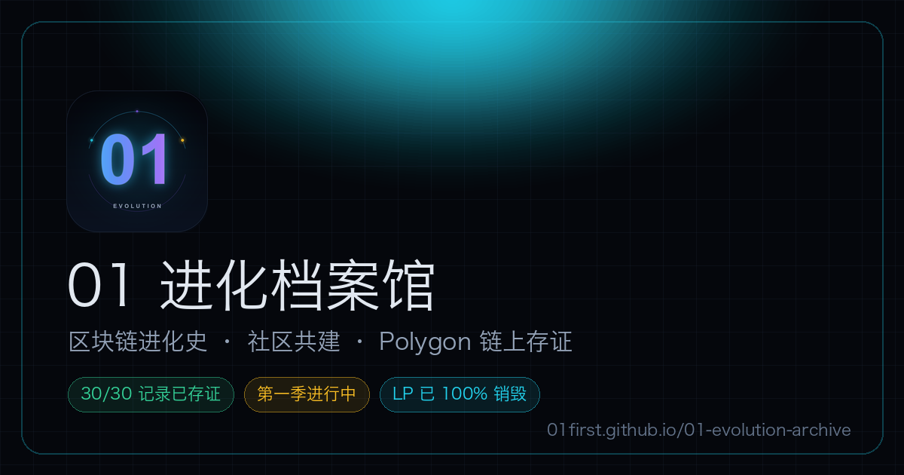

# 01 Evolution Archive · 01 进化档案馆


<p align="center"></p>

把“区块链的进化史”做成一个由社区共建、链上存证的公开档案。

**30 秒自证**（不用信我们，自己跑）：

```bash
git clone https://github.com/01First/01-evolution-archive.git && cd 01-evolution-archive
python3 contracts/verify_merkle.py --chain
```

输出 `Merkle 证明: 30/30 通过` 和 `结果: PASS`，说明档案内容与 Polygon 上的存证一致。

- 在线站点：https://01first.github.io/01-evolution-archive/
- 透明度页：https://01first.github.io/01-evolution-archive/transparency.html
- 存证网络：Polygon PoS
- 代币：ZeroOne（ZERO1）`0xb48c5204B8f4E59C33C8C0e4E89103cAcB4033Fa`（总量 100 亿枚，无增发、无 owner）
- 金库 Safe：`0x39C3730c1a5C42e763a8DEEA968a8A3D01010101`（5 owner / 3 阈值）
- 金库锁仓：`0xcD3C6414b2b98c8d1bA161C187EC8d08D55e4c35`（40 亿枚 · 730 天线性）
- 团队锁仓：`0x93370E8002D84946Fc579D9CF5FD7a6b88B85107`（25 亿枚 · 180 天 cliff + 1460 天线性）
- 创世空投分发：`0x64a18A19A6C2D8D328DC5facD927dD6cFBeff0DF`（owner 金库 Safe；未设根、未注资）
- 服务收款路由：`0xbe77D7f26E1095A12f0542DC2a4814F4344B2441`（USDT/USDC/USDC.e 直转金库 Safe，合约不留存）
- 第一季：2026-11-23 至 2027-01-31（进行中）
- DEX 交易对：暂无（当前无池，未上线交易）
- 旧币：已作废，不迁移、不映射旧持仓、不对旧持仓空投（见透明度页“旧币历史”）

## 代币分配

| 用途 | 比例 | 数量 | 存放 |
|---|---|---|---|
| 金库锁仓 | 40% | 40 亿枚 | TreasuryVesting `0xcD3C…4c35`，730 天线性 |
| 团队锁仓 | 25% | 25 亿枚 | TeamVesting `0x9337…5107`，180 天 cliff + 1460 天 |
| 社区奖励 | 20% | 20 亿枚 | 金库 Safe，按季度发放，每 8 个季度额度减半 |
| 流动性储备 | 10% | 10 亿枚 | 发行方 LP `0xE6Ad…11111111`，当前未建池 |
| 创世空投 | 5% | 5 亿枚 | 金库 Safe；分发合约 `0x64a1…f0DF` 已部署，未设根、未注资 |

## 链上存证

| 项目 | 值 |
|---|---|
| 存证合约 | `0x38bE675BD7E04AF650b1383EfF57124068d01F45` |
| owner | `0x39C3730c1a5C42e763a8DEEA968a8A3D01010101`（金库 Safe，3/5） |
| Merkle 根 | `0xbdff8289ef60fb345a8109b2151aa7adf2d445ecc83d03c38906c98e1c73b905` |
| 覆盖记录 | 30 / 30（recordCount = 30） |
| 存证交易 | `0xe7a9ace16cb6c2cd86daf946ae010730a5756c9250917edfaaa5cc678df0d728` |
| 部署交易 | `0x1e67535af33ba4c8296627df4d389df9cf14ed7559727d5d9749220db946bd50` |

指纹算法：`leaf = SHA-256(canonical JSON)`，`parent = SHA-256(min||max)`，奇数节点上提。
每条记录的独立 Merkle 证明见 [`contracts/merkle.json`](contracts/merkle.json)。

## 独立核验

```bash
python3 contracts/verify_merkle.py           # 离线核验 30 条记录与证明
python3 contracts/verify_merkle.py --chain   # 再与 Polygon 链上 anchors(0) 比对
```

预期输出：`Merkle 证明: 30/30 通过`、`结果: PASS`。

## 目录

```
index.html                     站点（单文件，无外部依赖）
01_logo.png                    Logo
POINTS.md                      第一季贡献积分规则
contracts/ArchiveAnchor.sol   存证合约源码
contracts/MerkleDistributor.sol 空投/奖励分发合约源码
contracts/PaymentRouter.sol   服务收款路由源码（收款直转金库，不留存）
contracts/merkle.json          30 条叶子、证明与根
contracts/verify_merkle.py     独立核验脚本
.github/ISSUE_TEMPLATE/        贡献登记 / 纠错模板
contributions.json             贡献台账（第一季）
```

## 贡献与积分

- 完整规则：[`POINTS.md`](POINTS.md)
- 登记入口：[提交贡献 Issue](https://github.com/01First/01-evolution-archive/issues/new?template=contribution.yml)
- 纠错入口：[提交纠错 Issue](https://github.com/01First/01-evolution-archive/issues/new?template=correction.yml)

执行流程：

1. 贡献者提交 Issue，附作品链接、账号和说明。
2. 两名复核人独立评分，质量系数取平均。
3. 复核结果写入 `contributions.json`，每周公示积分榜。
4. 季末快照、公示 7 天，冻结名单并生成 Merkle 兑换名单。
5. 兑换由参与者自行发起并支付网络费用；不承诺具体日期。

积分只记录贡献，不可转让，不构成任何收益承诺。奖励来自社区奖励池（20 亿枚），不新增发行、不动流动性储备和锁仓份额。

## 安全说明

- 本仓库不包含任何私钥、助记词或环境变量文件。
- 档案不募资、不承诺收益、不提供投资建议。
- 所有记录附公开来源；无法核验的内容不收。
- 合约写入权限归 owner，防止垃圾记录。

## 本地预览

```bash
python3 -m http.server 8080
# 打开 http://localhost:8080
```
